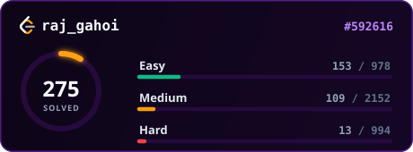

<!-- ═════════════════════════════════════════════════════════════════════
     RAJ GAHOI — GITHUB PROFILE README
     Style: Cinematic Editorial Monolith · Deep Obsidian & Velvet Violet
     Theme: Systems Engineering · Linux Foundation · Distributed Systems
     ═════════════════════════════════════════════════════════════════════ -->

<!-- ━━━━━━━━━━━━━━━━━━━━━━━━━ HERO BANNER ━━━━━━━━━━━━━━━━━━━━━━━━━ -->

  

 

  

 

<!-- ━━━━━━━━━━━━━━━━━━━ HELLO / EXECUTIVE SUMMARY ━━━━━━━━━━━━━━━━━━━ -->

 

> *“Engineering low-latency distributed systems, cluster memory diagnostic tooling, and mission-critical cloud infrastructure with mechanical sympathy and zero-cost abstractions.”*

I'm a <strong>Systems &amp; Distributed Software Engineer</strong> and active core contributor to the <strong>Linux Foundation (Valkey &amp; Valkey GLIDE)</strong>. I engineer high-throughput in-memory datastores, asynchronous event runtimes, and zero-drift network protocols — prioritizing mathematical invariants and deterministic performance under scale.

<!-- COORDINATES & TELEMETRY STRIP -->
<table width="100%" cellpadding="10" cellspacing="4">
<tr>
<td bgcolor="#11051F" align="center" width="25%">
  ●&nbsp; STATUS 
  <b>Open to Roles</b>
</td>
<td bgcolor="#11051F" align="center" width="25%">
  📍&nbsp; LOCATION 
  <b>Greater Noida, IN</b>
</td>
<td bgcolor="#11051F" align="center" width="25%">
  ⚡&nbsp; SPECIALIZATION 
  <b>Systems &amp; Cloud</b>
</td>
<td bgcolor="#11051F" align="center" width="25%">
  🐧&nbsp; AFFILIATION 
  <b>Linux Foundation</b>
</td>
</tr>
</table>

 

<!-- UNIFIED SOCIAL ACTIONS -->

  &nbsp;
  &nbsp;
  &nbsp;
  &nbsp;
  

 

---

<!-- ━━━━━━━━━━━━━━━━━ PROOF ON THE RECORD ━━━━━━━━━━━━━━━━━ -->

<table width="100%" cellpadding="14" cellspacing="4">
<tr>
<td bgcolor="#0E0517" align="center" width="20%">
  LINUX FOUNDATION 
  <strong>30+</strong> 
  <b>CORE OSS MERGES</b>
</td>
<td bgcolor="#0E0517" align="center" width="20%">
  SOURCE PLATFORMS 
  <strong>35</strong> 
  <b>PUBLIC REPOS</b>
</td>
<td bgcolor="#0E0517" align="center" width="20%">
  ALGORITHMIC RIGOR 
  <strong>300+</strong> 
  <b>LEETCODE PATTERNS</b>
</td>
<td bgcolor="#0E0517" align="center" width="20%">
  AUTOMATED SUITES 
  <strong>400+</strong> 
  <b>UNIT TESTS</b>
</td>
<td bgcolor="#0E0517" align="center" width="20%">
  COMPILED &amp; SCRIPTED 
  <strong>5</strong> 
  <b>SYSTEM LANGUAGES</b>
</td>
</tr>
</table>

 

<!-- ━━━━━━━━━━━━━━━━━━━━━━ CORE SYSTEMS & OSS ━━━━━━━━━━━━━━━━━━━━━━ -->

> *Production systems, not toy prototypes.*

<table width="100%" cellpadding="14" cellspacing="4">
<tr>
<td bgcolor="#0E0517" width="50%" valign="top">
<strong>LINUX FOUNDATION · VALKEY GLIDE · RUST / C++ CORE</strong>  
<strong>⚡ Valkey GLIDE Core Contributions</strong> 
Engineered transaction invariants (WATCH abort handling), Hash TTL read-only replica routing, and OpenTelemetry lifecycle diagnostics for Linux Foundation's official multi-language driver.  
● 5/5 Valkey CI Green &nbsp;·&nbsp; DCO Signed &nbsp;·&nbsp; Zero-Drift Telemetry  
&nbsp;
</td>
<td bgcolor="#0E0517" width="50%" valign="top">
<strong>SYSTEMS CLI · RUST / GO · DISTRIBUTED STORAGE</strong>  
<strong>🛰️ valkey-probe</strong> 
High-performance standalone cluster diagnostic CLI. Instantly detects hash-slot skew, key distribution imbalances, and cluster node health across 16,384 CRC16 slots in sub-milliseconds.  
● Zero-Allocation &nbsp;·&nbsp; CRC16 Slot Heatmap &nbsp;·&nbsp; &lt;1ms Latency  

</td>
</tr>
<tr>
<td bgcolor="#0E0517" width="50%" valign="top">
<strong>PYTHON ECOSYSTEM · RFC STANDARDS · SPECIFICATION</strong>  
<strong>📅 Python iCalendar Engine</strong> 
Core serialization engine optimization, vTimeZone fault-tolerance, and strict RFC 5545 / 7265 compliance for the world's standard Python calendar library.  
● 23 CI Suites Green &nbsp;·&nbsp; Coveralls 100% Patch Coverage &nbsp;·&nbsp; RFC 5545  

</td>
<td bgcolor="#0E0517" width="50%" valign="top">
<strong>FLAGSHIP SAAS · REACT 19 · TYPESCRIPT · NODE.JS</strong>  
<strong>🛡️ TrustNest</strong> 
Verified marketplace platform featuring a 5-dimension fraud prevention pipeline, multi-factor algorithmic trust scoring, and zero-drift geographic search across 140+ listings.  
● 140+ Verified Listings &nbsp;·&nbsp; Algorithmic Trust Engine &nbsp;·&nbsp; Full PWA  
&nbsp;
</td>
</tr>
</table>

 

<!-- DIAGNOSTIC TERMINAL STRIP -->

<pre><code>$ valkey-probe --cluster-audit --all-nodes
✔ CLUSTER HEALTH: OPTIMAL (16,384 / 16,384 SLOTS BALANCED) · SKEW: 0.00% · LATENCY: 0.42ms</code></pre>

 

---

<!-- ━━━━━━━━━━━━━━━━━━━ ARSENAL ━━━━━━━━━━━━━━━━━━━ -->

## ⚙️ &nbsp;Arsenal

<table width="100%" cellpadding="14" cellspacing="4">
<tr>
<td bgcolor="#0E0517" width="50%" valign="top">
<strong>#01 &nbsp;SYSTEMS &amp; CORE LANGUAGES</strong>  

</td>
<td bgcolor="#0E0517" width="50%" valign="top">
<strong>#02 &nbsp;DISTRIBUTED STORAGE &amp; MESSAGING</strong>  

</td>
</tr>
<tr>
<td bgcolor="#0E0517" width="50%" valign="top">
<strong>#03 &nbsp;CLOUD, RUNTIMES &amp; INFRASTRUCTURE</strong>  

</td>
<td bgcolor="#0E0517" width="50%" valign="top">
<strong>#04 &nbsp;OBSERVABILITY, TOOLS &amp; PATTERNS</strong>  

</td>
</tr>
</table>

 

---

<!-- ━━━━━━━━━━━━━━━━━━ A YEAR OF BUILDING ━━━━━━━━━━━━━━━━━━ -->

<!-- PACMAN CONTRIBUTION GRAPH -->

  <picture>
    <source media="(prefers-color-scheme: dark)" srcset="https://raw.githubusercontent.com/RajGahoi/RajGahoi/output/pacman-contribution-graph-dark.svg">
    <source media="(prefers-color-scheme: light)" srcset="https://raw.githubusercontent.com/RajGahoi/RajGahoi/output/pacman-contribution-graph.svg">
    
  </picture>

 

&nbsp;&nbsp;

 

---

<!-- ━━━━━━━━━━━━━━━━━━━ PROBLEM SOLVING & ALGORITHMIC PATTERNS ━━━━━━━━━━━━━━━━━━━ -->

## 🧩 &nbsp;Problem Solving &amp; Algorithmic Patterns

<pre><code>DECONSTRUCT ➔ PATTERN MATCH (GRAPHS / DP / TREES) ➔ OPTIMIZE TIME &amp; SPACE [O(N) / O(1)]</code></pre>

 

---

<!-- ━━━━━━━━━━━━━━━━━━━━━━ CONNECT ━━━━━━━━━━━━━━━━━━━━━━ -->

&nbsp;
&nbsp;

&nbsp;
&nbsp;

 

<!-- ━━━━━━━━━━━━━━━━━━━━━━ FOOTER ━━━━━━━━━━━━━━━━━━━━━━ -->

  

