<!-- ═══════════════════════════════════════════════════
     RAJ GAHOI — GITHUB PROFILE README
     Style: Cinematic · Editorial · Deep Obsidian & Cyber Sapphire
     Theme: Systems Engineering · Linux Foundation · Distributed Systems
     ═══════════════════════════════════════════════════ -->

<!-- ━━━━━━━━━━━━━━━━━━━━━━━━━ HERO ━━━━━━━━━━━━━━━━━━━━━━━━━ -->

 

<!-- ━━━━━━━━━━━━━━━━━━━ HELLO SECTION ━━━━━━━━━━━━━━━━━━━ -->
<table width="100%">
<tr>
<td valign="top" width="68%">

 

I'm a <strong>Systems &amp; Distributed Software Engineer</strong> and active core contributor to the <strong>Linux Foundation (Valkey &amp; Valkey GLIDE)</strong>. I engineer low-latency database infrastructure, async event runtimes, and high-throughput networking systems — with strict mechanical sympathy and zero-cost abstractions.

Driven by first principles. Committed to production craft. Always building.

 
&nbsp;
&nbsp;
&nbsp;
&nbsp;

</td>
<td valign="top" align="center" width="32%">

  
 
 
 

</td>
</tr>
</table>

 

---

<!-- ━━━━━━━━━━━━━━━━━ PROOF ON THE RECORD ━━━━━━━━━━━━━━━━━ -->

<table width="100%" cellpadding="12" cellspacing="4">
<tr>
<td bgcolor="#070C18" align="center" width="20%">
<strong>30+</strong> CORE OSS MERGES
</td>
<td bgcolor="#070C18" align="center" width="20%">
<strong>35</strong> PUBLIC REPOS
</td>
<td bgcolor="#070C18" align="center" width="20%">
<strong>300+</strong> LEETCODE PATTERNS
</td>
<td bgcolor="#070C18" align="center" width="20%">
<strong>400+</strong> UNIT TESTS
</td>
<td bgcolor="#070C18" align="center" width="20%">
<strong>5</strong> LANGUAGES
</td>
</tr>
</table>

 

<!-- ━━━━━━━━━━━━━━━━━━━━━━ CORE SYSTEMS & OSS ━━━━━━━━━━━━━━━━━━━━━━ -->

> *Production systems, not toy prototypes.*

<table width="100%" cellpadding="14" cellspacing="4">
<tr>
<td bgcolor="#070C18" width="50%" valign="top">
<strong>LINUX FOUNDATION · VALKEY GLIDE · RUST / C++ CORE</strong>  
<strong>⚡ Valkey GLIDE Core Contributions</strong> 
Engineered transaction invariants (WATCH abort handling), Hash TTL read-only replica routing, and OpenTelemetry lifecycle diagnostics for Linux Foundation's official multi-language driver.  
&nbsp;
</td>
<td bgcolor="#070C18" width="50%" valign="top">
<strong>SYSTEMS CLI · RUST / GO · DISTRIBUTED STORAGE</strong>  
<strong>🛰️ valkey-probe</strong> 
High-performance standalone cluster diagnostic CLI. Instantly detects hash-slot skew, key distribution imbalances, and cluster node health in sub-milliseconds.  

</td>
</tr>
<tr>
<td bgcolor="#070C18" width="50%" valign="top">
<strong>PYTHON ECOSYSTEM · RFC STANDARDS · SPECIFICATION</strong>  
<strong>📅 Python iCalendar Engine</strong> 
Core serialization engine optimization, vTimeZone fault-tolerance, and strict RFC 5545 / 7265 compliance for the world's standard Python calendar library.  

</td>
<td bgcolor="#070C18" width="50%" valign="top">
<strong>FLAGSHIP SAAS · REACT 19 · TYPESCRIPT · NODE.JS</strong>  
<strong>🛡️ TrustNest</strong> 
Verified marketplace platform featuring a 5-dimension fraud prevention pipeline, multi-factor algorithmic trust scoring, and zero-drift search across 140+ listings.  
&nbsp;
</td>
</tr>
</table>

 

---

<!-- ━━━━━━━━━━━━━━━━━━━ ARSENAL ━━━━━━━━━━━━━━━━━━━ -->

## ⚙️ &nbsp;Arsenal

<table width="100%" cellpadding="14" cellspacing="4">
<tr>
<td bgcolor="#070C18" width="50%" valign="top">
<strong>#01 &nbsp;SYSTEMS &amp; CORE LANGUAGES</strong>  

</td>
<td bgcolor="#070C18" width="50%" valign="top">
<strong>#02 &nbsp;DISTRIBUTED STORAGE &amp; MESSAGING</strong>  

</td>
</tr>
<tr>
<td bgcolor="#070C18" width="50%" valign="top">
<strong>#03 &nbsp;CLOUD, RUNTIMES &amp; INFRASTRUCTURE</strong>  

</td>
<td bgcolor="#070C18" width="50%" valign="top">
<strong>#04 &nbsp;OBSERVABILITY, TOOLS &amp; PATTERNS</strong>  

</td>
</tr>
</table>

 

---

<!-- ━━━━━━━━━━━━━━━━━━ A YEAR OF BUILDING ━━━━━━━━━━━━━━━━━━ -->

&nbsp;&nbsp;

 

---

<!-- ━━━━━━━━━━━━━━━━━━━ PROBLEM SOLVING & ALGORITHMIC PATTERNS ━━━━━━━━━━━━━━━━━━━ -->

## 🧩 &nbsp;Problem Solving &amp; Algorithmic Patterns

 

---

<!-- ━━━━━━━━━━━━━━━━━━━━━━ CONNECT ━━━━━━━━━━━━━━━━━━━━━━ -->

&nbsp;
&nbsp;

&nbsp;
&nbsp;

 

---

<!-- ━━━━━━━━━━━━━━━━━━━━━━ FOOTER ━━━━━━━━━━━━━━━━━━━━━━ -->

