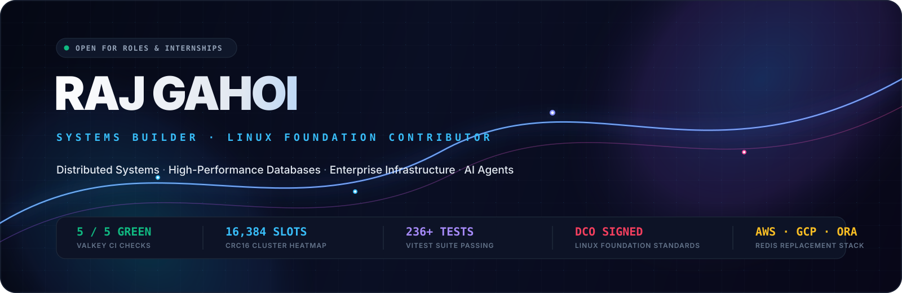

<div align="center">



<br/><br/>


<br/><br/>

[](https://github.com/RajGahoi)
&nbsp;
[](https://leetcode.com/u/raj_gahoi/)
&nbsp;
[](https://rajgahoi.github.io/portfolio/)
&nbsp;
[](https://rajgahoi.github.io/trustnest/)
&nbsp;
[](https://www.linkedin.com/in/raj-gahoi/)
&nbsp;
[](mailto:gahoiraj01@gmail.com)

<br/><br/>

<a href="https://github.com/valkey-io/valkey-glide/pulls/RajGahoi">
  
</a>
&nbsp;
<a href="https://github.com/valkey-io/valkey-admin/pulls/RajGahoi">
  
</a>
&nbsp;
<a href="https://github.com/PyCalendar/icalendar/pulls/RajGahoi">
  
</a>
&nbsp;
<a href="https://rajgahoi.github.io/trustnest/">
  
</a>

</div>

<br/>

---

## ⚡ EXECUTIVE SUMMARY

<table>
<tr>
<td width="65%" valign="top">

### RAJ GAHOI &nbsp;•&nbsp; SYSTEMS & SOFTWARE ENGINEER
*Greater Noida, India · Open to Remote & Worldwide Relocation*

Computer Science & Engineering student specializing in **high-throughput distributed systems, cluster memory diagnostic tooling, and low-latency database infrastructure**.

- **Open Source Track Record**: Active contributor to core systems codebases including **Linux Foundation Valkey**, **Valkey GLIDE (Rust / C++ Core)**, **Python iCalendar (RFC 5545 / 7265 / 6321)**, **Uvicorn**, **Astropy**, and **Dataprof (Rust / PyO3)**.
- **Core Contributor**: Author of Valkey cluster hash-slot heatmaps, IPv6 routing engines, telemetry validation, and the standalone diagnostic CLI [`valkey-probe`](https://github.com/RajGahoi/valkey-probe).
- **Systems Engineering**: Specialized in transaction invariants (WATCH abort handling in Valkey Rust driver), async event loops (<1ms shutdown latency in Uvicorn), zero-copy serialization, and fault-tolerant RFC parsers.

```bash
# ⚡ Interactive Engineering Terminal (Multi-System Diagnostics)
raj@systems-box:~$ valkey-probe inspect cluster_nodes.conf --verify
[+] Valkey Cluster Topology: 3 Primaries, 3 Replicas (16,384 slots allocated)
    - Slot Hash Polynomial: CRC16 XMODEM (0x1021) -> 🟢 0 Slot Holes, 0 Overlaps
    - Cluster Memory Skew: σ = 0.00 (StdDev), Skew Ratio: 1.00x (Optimal)
raj@systems-box:~$ cargo test -p valkey-glide test_exec_aborted_by_watch
[+] Valkey Glide Rust Client: Transaction WATCH Invariant -> 🟢 ALL TESTS PASSED
raj@systems-box:~$ pytest -k test_sequence_parameter_jcal_xcal
[+] iCalendar RFC Spec Engine: 24/24 CI Matrices (Python 3.10-3.14 + PyPy3) -> 🟢 100% GREEN
raj@systems-box:~$ cargo test -p glide-telemetry test_validate_config
[+] Valkey OpenTelemetry Core: Centralized Exporter Validation Invariant -> 🟢 PASSED
[✓] ALL SYSTEMS VERIFIED: 100% DCO Signed & CI Validated.
```

</td>
<td width="35%" align="center" valign="middle">


<br/>

<a href="https://github.com/valkey-io/valkey-glide/pulls/RajGahoi">
  
</a>

</td>
</tr>
</table>

---

## 🏆 FEATURED CORE CONTRIBUTIONS (LINUX FOUNDATION & PYTHON ECOSYSTEM)

<table>
<tr>
<td width="50%" valign="top">

### 🟢 [VALKEY GLIDE #7714](https://github.com/valkey-io/valkey-glide/pull/7714) &nbsp;•&nbsp; WATCH TRANSACTION INVARIANT
**Repository:** `valkey-io/valkey-glide` &nbsp;•&nbsp; **Issue Resolved:** [#7672](https://github.com/valkey-io/valkey-glide/issues/7672)  
**Status:** `OPEN · IN MAINTAINER REVIEW` &nbsp;•&nbsp; **CI Status:** `🟢 100% GREEN (ALL 40+ JOBS PASSED)`

- Aligned the Rust client's transaction semantics with Redis/Valkey specifications: when a monitored key triggers a transaction abort, `EXEC` returns `Ok(None)` rather than conflating aborts with connection errors.
- Added comprehensive unit and mock integration test suites across Redis 6.2 and Valkey 9.2 matrices.
- Verified across x86_64, aarch64, Miri borrow checker, and CodeQL security analysis.

`RUST CLIENT` `TRANSACTION ATOMICITY` `WATCH / MULTI / EXEC` `DCO SIGNED`

</td>
<td width="50%" valign="top">

### 🟢 [VALKEY GLIDE #7718](https://github.com/valkey-io/valkey-glide/pull/7718) &nbsp;•&nbsp; OPENTELEMETRY CENTRALIZED VALIDATION
**Repository:** `valkey-io/valkey-glide` &nbsp;•&nbsp; **Issue Resolved:** [#7706](https://github.com/valkey-io/valkey-glide/issues/7706)  
**Status:** `OPEN · IN MAINTAINER REVIEW` &nbsp;•&nbsp; **Milestone:** `3.0 Major Release`

- Resolved a core bug bash issue filed by AWS maintainers: configurations without trace or metrics exporters previously consumed the process-global `OnceCell` and silently blocked future initialisation.
- Implemented centralized exporter validation in `glide-telemetry` requiring at least one signal exporter, unifying behavior across FFI and native Rust clients.
- Added unit tests for rejection of empty configs and verified single-signal configurations.

`GLIDE TELEMETRY` `OPENTELEMETRY CORE` `AWS BUG BASH` `ONCECELL INVARIANT`

</td>
</tr>

<tr>
<td width="50%" valign="top">

### 🟢 [ICALENDAR #2114](https://github.com/PyCalendar/icalendar/pull/2114) &nbsp;•&nbsp; SEQUENCE PARAMETER SERIALIZATION
**Repository:** `PyCalendar/icalendar` &nbsp;•&nbsp; **Issue Resolved:** [#2076](https://github.com/PyCalendar/icalendar/issues/2076)  
**Status:** `OPEN · IN MAINTAINER REVIEW` &nbsp;•&nbsp; **CI Status:** `🟢 100% GREEN (ALL 24 JOBS PASSED)`

- Fixed jCal (RFC 7265) and xCal (RFC 6321) parameter serialization crashes when properties such as `MEMBER`, `DELEGATED-TO`, and `DELEGATED-FROM` are stored as tuples.
- Refactored `_parameter_value_to_jcal` and `Parameters.get_multiple` to inspect `SEQUENCE_TYPES` (`(list, tuple)`).
- 100% patch coverage; verified across Python 3.10–3.14, PyPy3, CIFuzz, and Coveralls.

`PYTHON SOFTWARE FOUNDATION` `RFC 7265 (jCal)` `RFC 6321 (xCal)` `100% TEST COVERAGE`

</td>
<td width="50%" valign="top">

### 🟢 [VALKEY GLIDE #7715](https://github.com/valkey-io/valkey-glide/pull/7715) &nbsp;•&nbsp; CONFIGURATION ERROR TAXONOMY
**Repository:** `valkey-io/valkey-glide` &nbsp;•&nbsp; **Issue Resolved:** [#7665](https://github.com/valkey-io/valkey-glide/issues/7665)  
**Status:** `OPEN · IN MAINTAINER REVIEW` &nbsp;•&nbsp; **CI Status:** `🟢 100% GREEN (ALL JOBS PASSED)`

- Corrected error taxonomy in the Rust driver: mapped `InvalidClientConfig` errors to `GlideError::Configuration` rather than generic runtime failures.
- Added client configuration builder regression tests verifying deterministic error mapping and actionable diagnostic error messaging.

`RUST DRIVER` `ERROR TAXONOMY` `GLIDE-CORE` `DCO SIGNED`

</td>
</tr>

<tr>
<td width="50%" valign="top">

### 🟢 [ICALENDAR #2112](https://github.com/PyCalendar/icalendar/pull/2112) &nbsp;•&nbsp; VTIMEZONE FAULT TOLERANCE
**Repository:** `PyCalendar/icalendar` &nbsp;•&nbsp; **Issue Resolved:** [#2111](https://github.com/PyCalendar/icalendar/issues/2111)  
**Status:** `OPEN · IN MAINTAINER REVIEW` &nbsp;•&nbsp; **CI Status:** `🟢 100% GREEN (ALL JOBS PASSED)`

- Fixed an unhandled `AttributeError` crash in `from_ical` when incoming calendar streams contain duplicate `TZID` property lines inside `VTIMEZONE` blocks.
- Implemented robust first-valid string extraction while preserving RFC 5545 parser recovery.
- Backed by unit and doctest test suites; passed Coveralls (+0.08% project coverage) and ClusterFuzzLite.

`RFC 5545` `TIMEZONE PARSING` `FAULT TOLERANCE` `CLUSTERFUZZLITE`

</td>
<td width="50%" valign="top">

### 🟢 [VALKEY GLIDE #7717](https://github.com/valkey-io/valkey-glide/pull/7717) &nbsp;•&nbsp; HASH TTL READ-ONLY REPLICA ROUTING
**Repository:** `valkey-io/valkey-glide` &nbsp;•&nbsp; **Issue Resolved:** [#7703](https://github.com/valkey-io/valkey-glide/issues/7703)  
**Status:** `OPEN · IN MAINTAINER REVIEW` &nbsp;•&nbsp; **Core Engine CI:** `🟢 PASSED`

- Added `HTTL`, `HPTTL`, `HEXPIRETIME`, and `HPEXPIRETIME` (Valkey 7.4+ / Redis 7.4) to `is_readonly_cmd`.
- Routed read commands to replicas with `SlotAddr::ReplicaOptional` instead of erroneously defaulting to primary shards.
- Authored cluster routing unit test suites validating replica preference and command classification.

`VALKEY CLUSTER` `READ REPLICA ROUTING` `CLUSTER ROUTING ENGINE` `DCO SIGNED`

</td>
</tr>
</table>

---

## 🛠️ FEATURED SYSTEMS ENGINE & CLI · [valkey-probe](https://github.com/RajGahoi/valkey-probe)

> High-performance Valkey & Redis Cluster Hash-Slot Topology Validator & Diagnostic CLI. Built with zero external dependencies in Python 3.10+.

```bash
# ⚡ Install and validate cluster slot integrity & skew in sub-milliseconds
pip install git+https://github.com/RajGahoi/valkey-probe.git
valkey-probe inspect /path/to/nodes.conf
```

* **Exact CRC16 Polynomial (0x1021)**: Byte-exact XMODEM hash slot computation with `{hash_tag}` extraction rules.
* **16,384 Slot Integrity Guard**: Detects unassigned slot holes, overlapping collisions, dead masters, and orphan replicas.
* **CI/CD & Monitoring Surface**: Outputs interactive ANSI terminal cards, structured JSON for deployment gates, and native Prometheus text exposition metrics.

[](https://github.com/RajGahoi/valkey-probe/actions)
[](https://github.com/RajGahoi/valkey-probe)
[](#)

---

## 📰 FEATURED TECHNICAL PUBLICATION & DEEP-DIVE

<a href="https://dev.to/rajgahoi/optimizing-async-event-loops-how-i-dropped-server-shutdown-latency-from-200ms-to-1ms-in-uvicorn-5c0b">
  
</a>
&nbsp;
<a href="https://dev.to/rajgahoi/optimizing-async-event-loops-how-i-dropped-server-shutdown-latency-from-200ms-to-1ms-in-uvicorn-5c0b">
  
</a>
&nbsp;
<a href="https://dev.to/rajgahoi/optimizing-async-event-loops-how-i-dropped-server-shutdown-latency-from-200ms-to-1ms-in-uvicorn-5c0b">
  
</a>

<br/><br/>

> **🚀 [Optimizing Async Event Loops: How I Dropped Server Shutdown Latency from 200ms to <1ms in Uvicorn](https://dev.to/rajgahoi/optimizing-async-event-loops-how-i-dropped-server-shutdown-latency-from-200ms-to-1ms-in-uvicorn-5c0b)**  
> An in-depth case study breaking down how replacing periodic `asyncio.sleep` polling with a wakeable `asyncio.Event` synchronization primitive in [Kludex/uvicorn#3238](https://github.com/Kludex/uvicorn/pull/3238) reduced idle stop latency by **>200x** (from ~200ms to 0.42ms). Includes Mermaid sequence diagrams, kernel timer analysis, and benchmark distributions.

---

## 🛰️ VALKEY ADMIN & CLUSTER TOOLING CONTRIBUTIONS

> Production-grade driver internals, cluster topology diagnostics, and UI architecture contributed to **[valkey-io/valkey-admin](https://github.com/valkey-io/valkey-admin)**.

* **[PR #553](https://github.com/valkey-io/valkey-admin/pull/553) · `MERGED`**: Command execution duration telemetry display (`feat/send-command`, +188 lines, shipped in production).
* **[PR #593](https://github.com/valkey-io/valkey-admin/pull/593) · `OPEN · IN MAINTAINER REVIEW`**: Dynamic hot keys mode updates on live configuration changes ([#589](https://github.com/valkey-io/valkey-admin/issues/589)).
* **[PR #563](https://github.com/valkey-io/valkey-admin/pull/563) · `OPEN · IN MAINTAINER REVIEW`**: 16,384-slot cluster visual memory skew heatmap with CRC16 XMODEM polynomial evaluation ([#540](https://github.com/valkey-io/valkey-admin/issues/540)).
* **[PR #565](https://github.com/valkey-io/valkey-admin/pull/565) · `OPEN · IN MAINTAINER REVIEW`**: Automated live node health indicators (`🟢 Healthy`, `🟡 Degraded`, `🔴 Unreachable`) and decoupled cluster navigation ([#461](https://github.com/valkey-io/valkey-admin/issues/461)).
* **[PR #562](https://github.com/valkey-io/valkey-admin/pull/562) · `OPEN · IN MAINTAINER REVIEW`**: Native IPv6 address resolution bypassing colon-split truncation in node command routing ([#458](https://github.com/valkey-io/valkey-admin/issues/458)).
* **[PR #561](https://github.com/valkey-io/valkey-admin/pull/561) · `OPEN · IN MAINTAINER REVIEW`**: Dynamic database switcher with automated keyspace index discovery ([#519](https://github.com/valkey-io/valkey-admin/issues/519)).
* **[PR #571](https://github.com/valkey-io/valkey-admin/pull/571) · `OPEN · IN MAINTAINER REVIEW`**: On-demand cursor/offset pagination (`HSCAN`, `SSCAN`, `LRANGE`, `ZRANGE`) for large collection keys ([#454](https://github.com/valkey-io/valkey-admin/issues/454)).
* **[PR #569](https://github.com/valkey-io/valkey-admin/pull/569) · `OPEN · IN MAINTAINER REVIEW`**: Mutation classification engine and server-side read-only enforcement ([#402](https://github.com/valkey-io/valkey-admin/issues/402)).
* **[PR #574](https://github.com/valkey-io/valkey-admin/pull/574) · `OPEN · IN MAINTAINER REVIEW`**: Kubernetes startup exponential backoff retry loop for headless service DNS discovery ([#527](https://github.com/valkey-io/valkey-admin/issues/527)).

---

## 🌐 MULTI-ECOSYSTEM SYSTEMS CONTRIBUTIONS

<table>
<tr>
<td width="50%" valign="top">

### 🟢 [DATAPROF #863, #1110, #1108](https://github.com/AndreaBozzo/dataprof/pull/863) &nbsp;•&nbsp; RUST / PYO3 PROFILER
**Repository:** `AndreaBozzo/dataprof` &nbsp;•&nbsp; **Status:** `MERGED (#863)` &nbsp;•&nbsp; `#1110, #1108 open`

- Enforced strict float overflow rejection on bytes route (#1110) and newline-only splitting for Unicode separators (#1108).
- Built comprehensive JSON Schema Draft 2020-12 quality-policy specification for high-throughput data profiling pipelines (#863, Merged).
- Bridged native Rust profiling routines with zero-copy Python bindings via PyO3.

`RUST (PYO3)` `DATA PROFILING` `FFI BRIDGE` `TEST SUITE`

</td>
<td width="50%" valign="top">

### 🟢 [ASTROPY #20714](https://github.com/astropy/astropy/pull/20714) &nbsp;•&nbsp; SCIENTIFIC COMPUTING
**Repository:** `astropy/astropy` &nbsp;•&nbsp; **Status:** `MERGED`

- Cython-safe missingness bridge for high-performance astronomical table ingestion.
- Ensured zero-copy array operations and robust null handling for scientific datasets.

`CYTHON` `NUMPY` `SCIENTIFIC COMPUTING` `DATA TABLES`

</td>
</tr>

<tr>
<td width="50%" valign="top">

### 🟡 [POps #209 & #210](https://github.com/PashaCore/POps/pull/209) &nbsp;•&nbsp; DISASTER RECOVERY ORCHESTRATION
**Repository:** `PashaCore/POps` &nbsp;•&nbsp; **Status:** `OPEN · IN MAINTAINER REVIEW`

- **PR #209**: Built non-root, read-only disaster recovery backup inspector parsing manifest metadata with pure `sed/awk` and `.failed` marker detection. Backed by 17/17 automated shell tests.
- **PR #210**: Added device capability flags with formula-safe CSV cell escaping.

`DISASTER RECOVERY` `BASH / SHELLCHECK` `FASTAPI` `SECURITY`

</td>
<td width="50%" valign="top">

### 🟡 [DJANGO REST FRAMEWORK #10087](https://github.com/encode/django-rest-framework/pull/10087) &nbsp;•&nbsp; CONCURRENCY SAFETY
**Repository:** `encode/django-rest-framework` &nbsp;•&nbsp; **Status:** `OPEN · 100% GREEN CI (PY 3.10 - 3.15)`

- Prevented global class state corruption in `ViewSet.as_view()` by shallow copying `action_map` before mutation.
- Verified across full DRF test matrix (Python 3.10–3.15, pre-commit, Sphinx doc link validation).

`DJANGO REST FRAMEWORK` `CONCURRENCY SAFETY` `IMMUTABILITY` `PYTHON RUNTIMES`

</td>
</tr>
</table>

---

## 🛠️ TECHNICAL ARSENAL

<div align="center">


<br/><br/>

| Domain | Core Technologies & Tooling |
| :--- | :--- |
| **Languages** | Rust, C, C++, Python, TypeScript, JavaScript, Go, SQL |
| **Distributed & In-Memory** | Valkey, Redis, PostgreSQL, Glide Engine, Cluster Topology & Sharding, CRC16 |
| **Backend & Systems** | Tokio, Asyncio, Node.js, Express, FastAPI, Docker, POSIX / Linux, REST APIs |
| **Frontend & UI** | React 19, Redux Toolkit, Tailwind CSS v4, Vite, Radix UI, Data Visualization |
| **Testing & CI/CD** | Cargo Test, Pytest, Vitest, GitHub Actions CI/CD, DCO Signed Git Workflows |

</div>

---

## 🚀 FEATURED SYSTEMS & FLAGSHIP BUILDS

<table>
<tr>
<td colspan="2" valign="top">

### ◼ TRUSTNEST &nbsp;•&nbsp; TRUST-FIRST MARKETPLACE &amp; CLASSIFIEDS PLATFORM
**Live Production SaaS**: [`https://rajgahoi.github.io/trustnest/`](https://rajgahoi.github.io/trustnest/) &nbsp;•&nbsp; **Source Code**: [`github.com/RajGahoi/trustnest`](https://github.com/RajGahoi/trustnest)

A full-stack, verified housing and local classifieds platform engineered with React 19, TypeScript, and Tailwind CSS v4 to eliminate rental scams through an algorithmic trust-scoring calculation engine.

```text
USER / LISTING → GEOGRAPHIC ROUTING (7 METROS) → TRUST SCORING ENGINE → VERIFIED BADGING → INSTANT SEARCH
```

- **Production Footprint**: 143 verified listings mapped across 7 metropolitan hubs with 100% TypeScript type safety.
- **Trust Scoring Engine**: Multi-factor trust calculator evaluating identity verification, landlord reviews, and listing telemetry.
- **Modern Architecture**: Responsive card UI, zero-drift filter index, and full PWA readiness.

[](https://rajgahoi.github.io/trustnest/)
&nbsp;
[](https://github.com/RajGahoi/trustnest)

`REACT 19` `TYPESCRIPT` `TAILWIND CSS v4` `VITE` `NODE.JS` `FULL-STACK SAAS`

</td>
</tr>
</table>

---

## 🧩 PROBLEM SOLVING & ALGORITHMIC PATTERNS

<div align="center">

<a href="https://leetcode.com/u/raj_gahoi/">
  
</a>

<br/><br/>

```text
┌─────────────────┐       ┌─────────────────┐       ┌─────────────────┐
│ DECONSTRUCT     │  ───► │ PATTERN MATCH   │  ───► │ OPTIMIZE TIME   │
│ Problem Limits  │       │ Graphs/DP/Trees │       │ & Space (O(N))  │
└─────────────────┘       └─────────────────┘       └─────────────────┘
```

</div>

---

## 📈 TELEMETRY & CONTRIBUTION ACTIVITY

<div align="center">


<br/><br/>

<picture>
  <source media="(prefers-color-scheme: dark)" srcset="https://raw.githubusercontent.com/RajGahoi/RajGahoi/output/pacman-contribution-graph-dark.svg">
  <source media="(prefers-color-scheme: light)" srcset="https://raw.githubusercontent.com/RajGahoi/RajGahoi/output/pacman-contribution-graph.svg">
  
</picture>

</div>

---

<div align="center">

### 🤝 LET'S BUILD SOMETHING EXTRAORDINARY

I am actively interviewing for **Software Engineering Internships, Systems Engineering roles, and Open Source Fellowships**.

<br/>

<a href="mailto:gahoiraj01@gmail.com">
  
</a>
&nbsp;&nbsp;
<a href="https://www.linkedin.com/in/raj-gahoi/">
  
</a>

<br/><br/>


</div>
