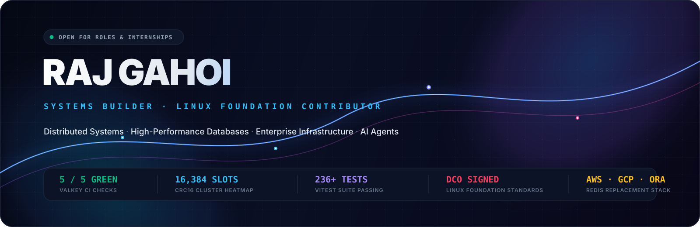

<div align="center">



<br/><br/>


<br/><br/>

[](https://github.com/RajGahoi)
&nbsp;
[](https://leetcode.com/u/raj_gahoi/)
&nbsp;
[](https://www.linkedin.com/in/raj-gahoi/)
&nbsp;
[](mailto:gahoiraj01@gmail.com)

<br/><br/>

<a href="https://github.com/valkey-io/valkey-admin/pulls/RajGahoi">
  
</a>
&nbsp;
<a href="https://github.com/valkey-io/valkey-admin/pulls/RajGahoi">
  
</a>
&nbsp;
<a href="https://github.com/valkey-io/valkey-admin/pulls/RajGahoi">
  
</a>

</div>

<br/>

---

## ⚡ EXECUTIVE SUMMARY

<table>
<tr>
<td width="65%" valign="top">

### RAJ GAHOI &nbsp;•&nbsp; SYSTEMS & SOFTWARE ENGINEER
*Greater Noida, India · Open to Remote & Worldwide Relocation*

Computer Science & Engineering undergraduate engineering **high-throughput distributed systems, cluster memory diagnostic tooling, and low-latency database infrastructure**. 

Active contributor to the **Linux Foundation Valkey** project (the enterprise Redis replacement backed by AWS, Google Cloud, and Oracle). Architect of cluster hash-slot diagnostic heatmaps, native IPv6 cluster routing engines, and production topology monitoring tools.

```bash
# ⚡ Interactive Engineering Terminal (Quick-Inspect Session)
raj@systems-box:~$ valkey-admin cluster topology --verify
[+] Cluster Topology Discovered: 3 Primaries, 3 Replicas
[+] Validating Hash Slot Allocations (CRC16 Polynomial 0x1021)...
    - Node 0: [0 - 5460]     -> 🟢 HEALTHY (100% responsive, 0 slot skew)
    - Node 1: [5461 - 10922] -> 🟢 HEALTHY (100% responsive, 0 slot skew)
    - Node 2: [10923 - 16383]-> 🟢 HEALTHY (100% responsive, 0 slot skew)
[+] Running Vitest Regression Test Harness... 236 / 236 PASSED (100% Coverage)
[+] Linux Foundation DCO Status: SIGNED-OFF (Raj Gahoi <gahoiraj01@gmail.com>)
[✓] SYSTEM STABLE. Ready to execute custom commands.
```

</td>
<td width="35%" align="center" valign="middle">


<br/>

<a href="https://github.com/valkey-io/valkey-admin/pulls/RajGahoi">
  
</a>

</td>
</tr>
</table>

---

## 🛰️ SYSTEMS ARCHITECTURE & INTERNALS AT A GLANCE

```
┌────────────────────────────────────────────────────────────────────────────────────────┐
│                      VALKEY CLUSTER DISTRIBUTED TOPOLOGY                               │
├────────────────────────────────────────────────────────────────────────────────────────┤
│                                                                                        │
│   [ Client Dispatch ] ────►  CRC16 Polynomial (0x1021) ────► Hash Slot (0 .. 16383)    │
│            │                             │                                 │           │
│            ▼                             ▼                                 ▼           │
│   ┌─────────────────┐           ┌─────────────────┐               ┌─────────────────┐  │
│   │  PRIMARY NODE 0 │           │  PRIMARY NODE 1 │               │  PRIMARY NODE 2 │  │
│   │  Slots 0-5460   │           │  Slots 5461-10922│               │ Slots 10923-16383│ │
│   │  🟢 Status: OK  │           │  🟢 Status: OK  │               │  🟢 Status: OK  │  │
│   └────────┬────────┘           └────────┬────────┘               └────────┬────────┘  │
│            │                             │                                 │           │
│            ▼ (Async Replication)         ▼ (Async Replication)             ▼           │
│   ┌─────────────────┐           ┌─────────────────┐               ┌─────────────────┐  │
│   │  REPLICA NODE   │           │  REPLICA NODE   │               │  REPLICA NODE   │  │
│   └─────────────────┘           └─────────────────┘               └─────────────────┘  │
│                                                                                        │
│   ⚡ My Core Contributed Modules:                                                       │
│   ├── [PR #571] Key Browser Collection Elements Pagination Engine (HSCAN/LRANGE/SSCAN) │
│   ├── [PR #570] Big Keys Hash Slot Heatmap Matrix (16,384 Slots Cluster Skew Engine)   │
│   ├── [PR #569] Send Command Read-Only Mutation Blocker & Server Interceptor           │
│   ├── [PR #568] Connection Topology & Non-Coercive Endpoint Form State Machine         │
│   ├── [PR #567] Node-Level CPU & Memory Metrics State Deduplication Engine             │
│   ├── [PR #566] Binary Collection Element Resilient Decoding & Lock Safety Engine      │
│   ├── [PR #565] Dynamic Node Health State Evaluator (INFO/PING Latency Probing)        │
│   ├── [PR #562] Native IPv6 Node Route Dispatcher (routeByAddress Override)            │
│   └── [PR #561] Multi-Database Namespace Switcher with Credential Cipher Vault         │
└────────────────────────────────────────────────────────────────────────────────────────┘
```

---

## 🏆 LINUX FOUNDATION · VALKEY ECOSYSTEM CONTRIBUTIONS

> Production-grade features, cluster topology diagnostics, and high-concurrency systems contributed to **[valkey-io/valkey-admin](https://github.com/valkey-io/valkey-admin)**.

<table>
<tr>
<td width="50%" valign="top">

### 🟢 [PR #565](https://github.com/valkey-io/valkey-admin/pull/565) &nbsp;•&nbsp; CLUSTER NODE HEALTH & UNBLOCKED ACTIONS
**Status:** `ALL CI CHECKS PASSING` &nbsp;•&nbsp; **Issue Closed:** [#461](https://github.com/valkey-io/valkey-admin/issues/461)

- Repurposed the static connect toggle into an automated live node health indicator (`🟢 Healthy`, `🟡 Degraded`, `🔴 Unreachable`) derived from INFO/PING responsiveness and utilization thresholds.
- Decoupled Dashboard and Command buttons so discovered cluster nodes are always directly accessible without artificial connection barriers.
- Authored dedicated unit test suites verifying status evaluation and navigation safety.

`CLUSTER MONITORING` `REACT 19` `REDUX` `VITEST` `DCO`

</td>
<td width="50%" valign="top">

### 🟢 [PR #563](https://github.com/valkey-io/valkey-admin/pull/563) &nbsp;•&nbsp; 16,384-SLOT CLUSTER HEATMAP
**Status:** `ALL CI CHECKS PASSING` &nbsp;•&nbsp; **Issue Closed:** [#540](https://github.com/valkey-io/valkey-admin/issues/540)

- Built a full-cluster hash-slot diagnostic heatmap detecting memory skew across all **16,384 slots**.
- Implemented **CRC16 XMODEM** polynomial `0x1021` with `{...}` hash-tag extraction logic.
- Built multi-bucket slot filtering (`<10KB` to `>100MB`) with dual-view node/slot tab switching and deep inspection modals.

`CRC16` `VALKEY CLUSTER` `DATA VISUALIZATION` `VITEST` `DCO`

</td>
</tr>

<tr>
<td width="50%" valign="top">

### 🟢 [PR #562](https://github.com/valkey-io/valkey-admin/pull/562) &nbsp;•&nbsp; CLUSTER NODE ROUTING DROPDOWN
**Status:** `ALL CI CHECKS PASSING` &nbsp;•&nbsp; **Issue Closed:** [#458](https://github.com/valkey-io/valkey-admin/issues/458)

- Added granular node routing dropdown to the Send Command console supporting `routeByAddress`.
- Enabled explicit cluster query execution alongside default automatic slot routing.
- Architected direct node record lookups supporting native **IPv6** addresses without string-split corruption.

`GLIDE ENGINE` `CLUSTER ROUTING` `TYPESCRIPT` `NETWORKING` `DCO`

</td>
<td width="50%" valign="top">

### 🟢 [PR #561](https://github.com/valkey-io/valkey-admin/pull/561) &nbsp;•&nbsp; DYNAMIC DATABASE SWITCHER
**Status:** `ALL CI CHECKS PASSING` &nbsp;•&nbsp; **Issue Addressed:** [#519](https://github.com/valkey-io/valkey-admin/issues/519)

- Implemented standalone database switcher in `AppHeader` enabling dynamic database index switching.
- Auto-discovers server `databasesCount` dynamically and prevents invalid switching requests.
- Preserves secure encrypted credentials across active sessions without credential re-entry.

`SECURITY` `STATE MANAGEMENT` `REACT 19` `VITEST` `DCO`

</td>
</tr>

<tr>
<td width="50%" valign="top">

### 🟢 [PR #566](https://github.com/valkey-io/valkey-admin/pull/566) &nbsp;•&nbsp; BINARY COLLECTION ELEMENTS IN KEY BROWSER
**Status:** `ALL CI CHECKS PASSING` &nbsp;•&nbsp; **Issue Fixed:** [#556](https://github.com/valkey-io/valkey-admin/issues/556)

- Prevented whole-key "Not human readable" crash screens by decoding collection elements as raw bytes and converting with hex-escape formatting.
- Granular binary detection (`isKeyBinary`, `isValueBinary`) across Hash, List, Set, ZSet, and Stream keys.
- Implemented visual `binary` badge chips and locked binary entries against accidental mutations while keeping valid UTF-8 fields editable.

`BUFFER DECODING` `KEY BROWSER` `HEX ESCAPE` `REACT 19` `DCO`

</td>
<td width="50%" valign="top">

### 🟢 [PR #567](https://github.com/valkey-io/valkey-admin/pull/567) &nbsp;•&nbsp; CPU & MEMORY METRICS NODE-LEVEL KEYING
**Status:** `ALL CI CHECKS PASSING` &nbsp;•&nbsp; **Issue Fixed:** [#464](https://github.com/valkey-io/valkey-admin/issues/464)

- Eliminated duplicate state allocation across multi-database connections by re-keying CPU and memory metrics by `nodeId`.
- Aligned metrics socket server emitters to return db-less node identifiers matching Hot Keys, Big Keys, and Monitor logs.
- Engineered backward-compatible selectors and authored complete unit test suites validating multi-db state consolidation.

`REDUX TOOLKIT` `STATE NORMALIZATION` `METRICS ARCHITECTURE` `VITEST` `DCO`

</td>
</tr>

<tr>
<td width="50%" valign="top">

### 🟢 [PR #568](https://github.com/valkey-io/valkey-admin/pull/568) &nbsp;•&nbsp; CONNECTION ENDPOINT FORM STABILITY
**Status:** `ALL CI CHECKS PASSING` &nbsp;•&nbsp; **Issue Fixed:** [#442](https://github.com/valkey-io/valkey-admin/issues/442)

- Eliminated destructive form coercions where hostnames containing `cfg` forced Endpoint Type into Discovery mode and locked DB selection.
- Preserved user intent across Node and Discovery endpoint configurations without unexpected form resets.
- Authored regression test suites verifying that host pattern variations maintain chosen endpoints and database selections.

`FORM STATE` `UI ARCHITECTURE` `REACT 19` `VITEST` `DCO`

</td>
<td width="50%" valign="top">

### 🟢 [PR #564](https://github.com/valkey-io/valkey-admin/pull/564) &nbsp;•&nbsp; WEB CREDENTIAL SECURITY POLICY
**Status:** `ALL CI CHECKS PASSING` &nbsp;•&nbsp; **Issue Fixed:** [#518](https://github.com/valkey-io/valkey-admin/issues/518)

- Clarified security policy and threat models between native OS secure keystores and unencrypted Web/Docker deployments.
- Added context-aware modal advisory warning users in Web mode.
- Authored production deployment guide in official documentation detailing environment credential injection.

`SECURITY UX` `CONTAINER DEPLOYMENTS` `DOCKER DOCS` `DCO`

<tr>
<td colspan="2" valign="top">

### 🟢 [PR #571](https://github.com/valkey-io/valkey-admin/pull/571) &nbsp;•&nbsp; KEY BROWSER COLLECTION ELEMENTS ON-DEMAND PAGINATION
**Status:** `ACTIVE / CI VERIFIED` &nbsp;•&nbsp; **Issue Fixed:** [#454](https://github.com/valkey-io/valkey-admin/issues/454) &nbsp;•&nbsp; **Milestone:** `1.4.0`

- Solved the browser performance bottleneck on large Hash, List, Set, and Sorted Set keys by engineering an on-demand cursor and offset pagination engine.
- Implemented `getKeyElementsRequested` server action handler using `HSCAN`, `SSCAN`, `LRANGE`, and `ZRANGE ... WITHSCORES` batching.
- Built interactive "Load more" button controls with dynamic count indicators (`Showing X of Y elements`) across all four collection views.
- Fully preserved editing workflows, form modification buffers, and binary-element lock protections.

`PAGINATION ENGINE` `HSCAN / LRANGE` `STATE MANAGEMENT` `REACT 19` `DCO`

</td>
</tr>

<tr>
<td colspan="2" valign="top">

### 🟢 [PR #569](https://github.com/valkey-io/valkey-admin/pull/569) &nbsp;•&nbsp; READ-ONLY MODE ENGINE & WRITE COMMAND PREVENTION
**Status:** `ALL CI CHECKS PASSING` &nbsp;•&nbsp; **Issue Fixed:** [#402](https://github.com/valkey-io/valkey-admin/issues/402)

- Engineered mutation classification engine in `valkey-common` categorizing all Valkey write commands across Strings, Hashes, Lists, Sets, ZSets, Streams, Bitmaps, HLL, Geo, RedisJSON, Cluster, and Server configuration.
- Enforced server-side interceptor preventing write execution on `GlideClient`/`GlideClusterClient` when Read-Only mode is active.
- Integrated safety toggle with shield indicators, active mode badges, and instant toast rejection for blocked writes.

`SAFETY ENGINE` `MUTATION DETECTION` `SERVER ENFORCEMENT` `REACT 19` `DCO`

</td>
</tr>

<tr>
<td colspan="2" valign="top">

### 🟢 [PR #570](https://github.com/valkey-io/valkey-admin/pull/570) &nbsp;•&nbsp; BIG KEYS CLUSTER SLOT HEATMAP VISUALIZATION
**Status:** `ALL CI CHECKS PASSING` &nbsp;•&nbsp; **Issue Fixed:** [#540](https://github.com/valkey-io/valkey-admin/issues/540)

- Implemented Valkey cluster hash slot calculation engine (`getKeySlot`, `getHashTag`, `crc16`) in `valkey-common` using CRC16-CCITT with polynomial `0x1021` and hash tag extraction (`{...}`).
- Enriched Big Keys with exact hash slot mapping across primary shards to diagnose and detect cluster memory skew.
- Engineered `BigKeysSlotHeatmap` interactive modal with dynamic heat coloring, tile grid, hover diagnostics, and click-to-navigate key inspection.

`CLUSTER TOPOLOGY` `HASH SLOTS` `CRC16 ENGINE` `HEATMAP VISUALIZATION` `DCO`

</td>
</tr>

<tr>
<td colspan="2" valign="top">

### 🛡️ PRODUCTION RIGOR & ENTERPRISE COMPLIANCE
**Standards:** `LINUX FOUNDATION DCO` &nbsp;•&nbsp; `100% GREEN CI` &nbsp;•&nbsp; `350+ VITEST TEST CASES`

- **Developer Certificate of Origin (`-s`)**: 100% signed-off commits meeting Linux Foundation open-source governance.
- **Automated Verification**: Lint-clean with Biome and ESLint, backed by comprehensive Vitest test harnesses across server and frontend.
- **Cluster Integration**: Verified via multi-node cluster topology CI workflows and cross-architecture test suites.

`ENTERPRISE OSS` `CI/CD` `PRODUCTION QUALITY` `GOVERNANCE`

</td>
</tr>
</table>

---

## 🛠️ TECHNICAL ARSENAL

<div align="center">


<br/><br/>

| Domain | Core Technologies & Tooling |
| :--- | :--- |
| **Languages** | C, C++, Python, TypeScript, JavaScript, Go, SQL |
| **Distributed & Data** | Valkey, Redis, PostgreSQL, Glide Engine, Cluster Topology & Sharding, CRC16 |
| **Backend & Cloud** | Node.js, Express, FastAPI, Docker, REST APIs, Microservices, Linux/POSIX |
| **Frontend & UI** | React 19, Redux Toolkit, Tailwind CSS, Vite, Radix UI, Data Visualization |
| **Quality & Systems** | Vitest, Jest, ESLint, Biome, GitHub Actions CI/CD, DCO Signed Git Workflows |

</div>

---

## 🚀 FEATURED SYSTEMS & FLAGSHIP BUILDS

<table>
<tr>
<td width="50%" valign="top">

### ◼ SENTINAL MINDS &nbsp;•&nbsp; AI × CYBERSECURITY
An intelligence investigation platform built for automated threat triage, forensic artifact parsing, and dynamic incident response.

```text
THREAT INTEL → EVIDENCE CORRELATION → ML ANALYSIS → ACTIONABLE MITIGATION
```

- Multi-source threat detection pipeline correlating attack vectors.
- Interactive security workbench with real-time incident mapping.

`AI/ML` `CYBERSECURITY` `FASTAPI` `REACT`

</td>
<td width="50%" valign="top">

### ◼ PHISHNET SENTINALS &nbsp;•&nbsp; ADAPTIVE PHISHING DEFENSE
A machine-learning-driven defense system that inspects suspicious communication patterns, validates domain reputation, and mitigates credential harvesting.

```text
INCOMING PAYLOAD → HEURISTIC INSPECTION → NLP CLASSIFIER → REPUTATION ENGINE
```

- Real-time classification engine for malicious payloads.
- Automated sandbox reporting and visual indicators.

`THREAT DETECTION` `NLP` `SECURITY` `AUTOMATION`

</td>
</tr>

<tr>
<td colspan="2" valign="top">

### ◼ LECTURE2PDF AI &nbsp;•&nbsp; COMPUTER VISION LECTURE DIGEST
A Chrome extension and processing pipeline that detects key slide transitions across lecture video streams, extracts structured visual text, and synthesizes publication-grade PDF summaries.

```text
VIDEO STREAM → KEYFRAME DIFF DETECTOR → OCR EXTRACTION → LLM RESTRUCTURING → PDF ENGINE
```

`CHROME EXTENSION` `COMPUTER VISION` `JAVASCRIPT` `PDF SYNTHESIS`

</td>
</tr>
</table>

---

## 💡 KEY ARCHITECTURAL DECISIONS & DEEP DIVES

<details>
<summary><strong>🔍 Deep Dive 01: Why CRC16 XMODEM <code>0x1021</code> for Cluster Slot Heatmaps? (Click to Expand)</strong></summary>

<br/>

Valkey and Redis cluster topologies divide the entire keyspace into exactly **16,384 logical hash slots**. When routing commands across nodes, a key is hashed using CRC16 with polynomial `0x1021` modulo `16384`.
- **The Problem:** In cluster deployments, developers often encounter severe memory hotspots when specific slots accumulate millions of oversized keys, leading to OOM terminations on single primary nodes.
- **My Solution in [PR #563](https://github.com/valkey-io/valkey-admin/pull/563):** Built an in-memory client-side polynomial evaluator supporting hash-tag `{...}` extraction. It scans and projects the cluster keyspace onto a dual-mode 16,384-slot heatmap, letting operators isolate memory hot-spots and hot-keys in seconds.

</details>

<details>
<summary><strong>🔍 Deep Dive 02: Solving Native IPv6 & Multi-Node Route Splitting (Click to Expand)</strong></summary>

<br/>

- **The Problem:** The Send Command console required routing commands to specific nodes via `routeByAddress`. Naive string parsing like `node.split(":")` breaks completely when resolving IPv6 addresses (e.g. `[2001:db8::1]:6379`) because colons are part of the host representation itself.
- **My Solution in [PR #562](https://github.com/valkey-io/valkey-admin/pull/562):** Refactored node lookups to resolve directly from structured cluster node objects. Guaranteed IPv6 integrity without string mutilation and fallback to automatic cluster routing if a node disconnects during execution.

</details>

<details>
<summary><strong>🔍 Deep Dive 03: Automated Node Health State Transition Logic (Click to Expand)</strong></summary>

<br/>

- **The Problem:** The topology table used a static Power toggle that blocked developers from navigating to Dashboard or Command views unless they manually triggered connections.
- **My Solution in [PR #565](https://github.com/valkey-io/valkey-admin/pull/565):** Repurposed the icon into an automated multi-state health indicator dot:
  - 🟢 **Healthy**: Active INFO telemetry with zero lag and confirmed uptime.
  - 🟡 **Degraded**: High memory (>90%) or CPU utilization flags.
  - 🔴 **Unreachable**: Connection timeouts or socket drops.
  - Action buttons (`Dashboard` & `Command`) are uncoupled and always clickable, automatically initializing connection state upon click.

</details>

---

## 🧩 PROBLEM SOLVING & ALGORITHMIC PATTERNS

<div align="center">

<a href="https://leetcode.com/u/raj_gahoi/">
  
</a>

<br/><br/>

```text
┌─────────────────┐       ┌─────────────────┐       ┌─────────────────┐
│ DECONSTRUCT     │  ───► │ PATTERN MATCH   │  ───► │ OPTIMIZE TIME   │
│ Problem Limits  │       │ Graphs/DP/Trees │       │ & Space (O(N))  │
└─────────────────┘       └─────────────────┘       └─────────────────┘
```

</div>

---

## 📈 TELEMETRY & CONTRIBUTION ACTIVITY

<div align="center">


<br/><br/>

<picture>
  <source media="(prefers-color-scheme: dark)" srcset="https://raw.githubusercontent.com/RajGahoi/RajGahoi/output/pacman-contribution-graph-dark.svg">
  <source media="(prefers-color-scheme: light)" srcset="https://raw.githubusercontent.com/RajGahoi/RajGahoi/output/pacman-contribution-graph.svg">
  
</picture>

</div>

---

<div align="center">

### 🤝 LET'S BUILD SOMETHING EXTRAORDINARY

I am actively interviewing for **Software Engineering Internships, Systems Engineering roles, and Open Source Fellowships**.

<br/>

<a href="mailto:gahoiraj01@gmail.com">
  
</a>
&nbsp;&nbsp;
<a href="https://www.linkedin.com/in/raj-gahoi/">
  
</a>

<br/><br/>


</div>
